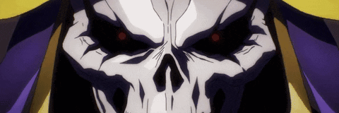
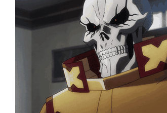

---

### 💀 Salut, moi c'est Panda

Développeur et configurateur de **serveurs de jeu** : Counter-Strike, Minecraft et FiveM / GTA V.
Je reprends aussi de vieux mods **Counter-Strike: Source** abandonnés depuis des années (2012-2013)
et je les fais tourner de nouveau sur le CS:S d'aujourd'hui : **SourceMod 1.12**, serveurs **64 bits**, bugs et failles corrigés.

- 🖥️ Installation et configuration de serveurs **Counter-Strike**, **Minecraft** et **FiveM / GTA V**
- 🏥 Je travaille sur **AsylumRP**
- 🔧 **SourcePawn**, plugins SourceMod et EventScripts
- 🐧 Serveurs de jeu sous **Linux** et **Docker**
- 🎮 Un peu de scripts **Roblox** à côté

 

---

### ⚔️ Projets mis en avant

| Projet | Description |
|---|---|
| [**CSS-EventScripts-Remastered**](https://github.com/WareZ57/CSS-EventScripts-Remastered) | EventScripts 2.1.1 qui retourne sur le CS:S actuel |
| [**CSS-WCS-Remastered**](https://github.com/WareZ57/CSS-WCS-Remastered) | Warcraft Source 0.78 pour EventScripts Remastered |
| [**CSS-War3Source-Remastered**](https://github.com/WareZ57/CSS-War3Source-Remastered) | War3Source 2.130 porté pour SourceMod 1.12 |
| [**CSS-THC-RPG-Remastered**](https://github.com/WareZ57/CSS-THC-RPG-Remastered) | THC RPG 0.8.3 : exploit d'XP et fuites mémoire corrigés |
| [**CSS-BaJail-Remastered**](https://github.com/WareZ57/CSS-BaJail-Remastered) | Pack ba_jail de 2012 audité et corrigé |
| [**CSS-RP-Remastered**](https://github.com/WareZ57/CSS-RP-Remastered) | Roleplay CS:S de 2013, débarrassé de ses backdoors |
| [**DHooks-x64-CSS**](https://github.com/WareZ57/DHooks-x64-CSS) | DHooks / BinTools / Metamod en x86_64 pour CS:S Linux |
| [**CSS-AntiSpoofer**](https://github.com/WareZ57/CSS-AntiSpoofer) | Bloque les usurpateurs de SteamID sur les serveurs No-Steam |
| [**UnVAC-RevEmu**](https://github.com/WareZ57/UnVAC-RevEmu) | Laisse entrer des joueurs bannis VAC choisis sur un serveur RevEmu |

---

### 🛠️ Outils

 

---

### 🖥️ Ma config

---

### 📊 Statistiques

